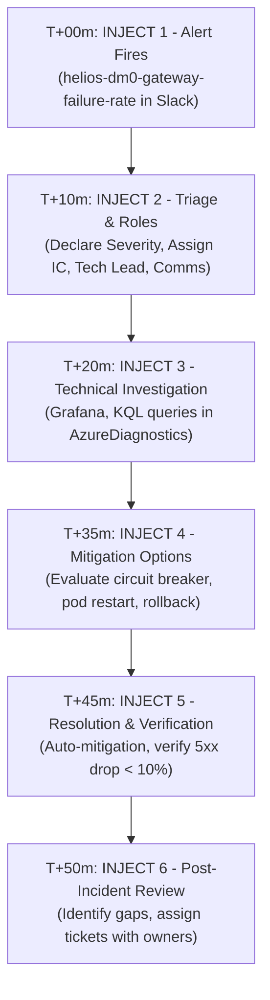

# SRE Tabletop Exercise Plan: DEMO (`dm0`) APIM Gateway 5xx Spike (AB#34970)

**Work Item:**  
**Parent Feature:** `AB#31391` (*Observability: S1 fixes and DEMO baseline*)  
**Compliance Standard:** SOC 2 Type II — CC7 (Incident Detection, Triage, Response & Post-Incident Review)  
**Target Environment:** DEMO (`dm0`)  
**Audit Hard Cutoff:** 
**Scenario Brief Delivery Date:**  
**Tabletop Execution Target:**   
**Lead SRE / Facilitator:** Dipak Singh  
**Participants:** Constantin Pricochi (Observability Lead), Maurice Kennedy (Infra Lead), Aditya Mehta (Platform SRE), Dipak Singh (Incident Commander / Facilitator)

---

## 1. Executive Summary & Compliance Context

Under **SOC 2 Trust Services Criteria CC7.3 and CC7.4**, an organization must demonstrate that:
1. Operational incidents are detected, classified, escalated, and resolved according to documented procedures.
2. The incident response procedure is tested periodically (at least annually) via a simulated or tabletop exercise.
3. Every exercise produces documented evidence: date, attendee list, chronological timeline, decisions made, operational gaps identified, and tracked follow-up corrective tickets with assigned owners.

This plan details the end-to-end strategy to build, pre-validate, execute, and document an **airtight SRE tabletop exercise** centered on a **5xx Failure Rate Spike on the `helios-dm0-apim` Gateway**.

```
+──────────────────────────────────────────────────────────────────────────────────────────+
|                                TABLETOP EXERCISE LIFECYCLE                               |
+──────────────────────────────────────────────────────────────────────────────────────────+
|  PHASE 1: BUILD & PRE-VALIDATE (Oct 19–21)                                               |
|  - Validate live alert rule, KQL query, and Slack relay routes                           |
|  - Draft Scenario Brief & Injects (Detect -> Triage -> Comms -> Fix -> PIR)              |
|  - Review Brief with Constantin (Due Wednesday, Oct 21)                                  |
+─────────────────────────────────────────────┬────────────────────────────────────────────+
                                              │
                                              ▼
+──────────────────────────────────────────────────────────────────────────────────────────+
|  PHASE 2: DRY-RUN & VERIFICATION (Oct 21–22)                                             |
|  - Test mock alert dispatch and KQL query responses                                      |
|  - Verify Grafana dashboard panels and log paths in helios-dm0-logs                      |
|  - Finalize session agenda and role assignments                                          |
+─────────────────────────────────────────────┬────────────────────────────────────────────+
                                              │
                                              ▼
+──────────────────────────────────────────────────────────────────────────────────────────+
|  PHASE 3: LIVE TABLETOP EXECUTION (Oct 22/23 - 60 Mins)                                  |
|  - Facilitate 60-min simulated incident walk-through with Constantin, Aditya, Maurice    |
|  - Capture live timestamps, decisions, comms, and process friction points                |
+─────────────────────────────────────────────┬────────────────────────────────────────────+
                                              │
                                              ▼
+──────────────────────────────────────────────────────────────────────────────────────────+
|  PHASE 4: PIR WRITE-UP & AUDIT PACKAGE (Oct 23–26)                                       |
|  - Write complete Incident Retrospective in ADO Wiki (/QRE/Incident Retrospectives)     |
|  - Create ADO User Stories/Bugs for all identified gaps with owners                      |
|  - Link evidence on AB#34970 and transition to Closed ahead of Oct 28 deadline           |
+──────────────────────────────────────────────────────────────────────────────────────────+
```

---

## 2. Technical Infrastructure Blueprint in `dm0`

The exercise exercises existing, verified infrastructure in `dm0` without touching production:

```
                  ┌───────────────────────────────────────────────┐
                  │                 API Consumers                 │
                  └───────────────────────┬───────────────────────┘
                                          │ HTTP Requests
                                          ▼
                  ┌───────────────────────────────────────────────┐
                  │          APIM: helios-dm0-apim                │
                  │        (helios-dm0-us-west3-rg)               │
                  └───────────────┬───────────────┬───────────────┘
                                  │               │
                     GatewayLogs  │               │ HTTP 500 / 503 Spike
                     (Diagnostic) │               │ (Simulated Backend Fault)
                                  ▼               ▼
┌───────────────────────────────────────────┐   ┌─────────────────────────────────────────┐
│ Log Analytics: helios-dm0-logs            │   │ Backends:                               │
│ - Table: AzureDiagnostics                 │   │ - helios-ontology-event-processor       │
│ - Category == "GatewayLogs"               │   │ - helios-plan-narration                 │
└─────────────────────┬─────────────────────┘   │ - kg-event-processor-dm0                │
                      │                         └─────────────────────────────────────────┘
                      │ Evaluated every 5m (PT15M window)
                      ▼
┌─────────────────────────────────────────────────────────────────────────────────────────┐
│ Alert Rule: helios-dm0-gateway-failure-rate (Severity 2)                                │
│ Query: AzureDiagnostics | where Category == "GatewayLogs" | where total >= 20           │
│        and todouble(failed)/total > 0.1                                                 │
└─────────────────────────────────────┬───────────────────────────────────────────────────┘
                                      │ Fires to Action Group
                                      ▼
┌─────────────────────────────────────────────────────────────────────────────────────────┐
│ Action Group: ag-helios-dm0-ops                                                         │
│ ├── Logic App Slack Relay: helios-dm0-alert-to-slack                                    │
│ └── Target Channel: #alerts-dm0-ops / #incident-dm0-tabletop                            │
└─────────────────────────────────────┬───────────────────────────────────────────────────┘
                                      │ Displays
                                      ▼
┌─────────────────────────────────────────────────────────────────────────────────────────┐
│ Grafana Dashboard: APIM Gateway Performance & Failure Rates                             │
│ - Failure rate % over time by API ID                                                    │
│ - Response code distribution (500, 502, 503, 504)                                       │
│ - Average & P95 latency                                                                 │
└─────────────────────────────────────────────────────────────────────────────────────────┘
```

### Component Details
1. **Target APIM Service:** `helios-dm0-apim` in `helios-dm0-us-west3-rg` (`Helios - Demo`, `bb47b7ba-e899-4c87-be6e-2f36dc1165c7`).
2. **Alert Rule:** `helios-dm0-gateway-failure-rate` (defined in alerts-gateway-failure-rate.tf).
   * Logic: Flags any API with $\ge 20$ calls in 15 minutes where $> 10\%$ answer with $5xx$.
   * Evaluation: Evaluated every 5 minutes (`PT5M`) over a 15-minute sliding window (`PT15M`).
   * Current exclusion: `telemetry-api` is excluded until `2026-10-23T00:00:00Z` in `dm0/monitoring.tfvars`. **Therefore, the scenario will focus on another live API, such as `ontology` or `plan-narration`.**
3. **Action Group:** `ag-helios-dm0-ops` connected to the Logic App webhook Slack relay.
4. **Log Analytics Destination:** `helios-dm0-logs`, querying `AzureDiagnostics` where `Category == "GatewayLogs"`.

---

## 3. The 60-Minute Tabletop Simulation Scenario

### Scenario Premise: "The Monday Morning Cascading 5xx Surge"
At 10:15 UTC, client applications report degraded service. APIM gateway `helios-dm0-apim` begins answering requests with HTTP `500 Internal Server Error` and `503 Service Unavailable`. The 5xx rate climbs to 42%, breaching the 10% threshold.

### Chronological Simulation Timeline (60 Minutes)



#### Detailed Injects Breakdown:

| Timestamp | Inject / Event | Activity & Team Action | What We Test & Validate |
|:---:|:---|:---|:---|
| **T+00m** | **Inject 1: Automated Detection** | Alert `helios-dm0-gateway-failure-rate` fires into `#alerts-dm0-ops`. | • Did the alert provide sufficient context?<br>• Is the runbook link attached?<br>• Was the alert noticed within SLA? |
| **T+10m** | **Inject 2: Triage & Incident Declaration** | On-call acknowledges alert; escalates to Incident. Declare incident channel `#incident-20261022-apim-5xx`. | • Who is the designated **Incident Commander (IC)**?<br>• What is the severity classification (Sev 1 vs Sev 2)?<br>• How are initial comms published? |
| **T+20m** | **Inject 3: Diagnostic Investigation** | Tech investigator runs KQL in Log Analytics and examines Grafana dashboard. | • Can the investigator quickly identify which `apiId_s` is failing?<br>• Are errors generated by APIM policy or the backend upstream (`backendResponseCode_d`)? |
| **T+35m** | **Inject 4: Mitigation Strategy** | Team evaluates containment: 1) Scale out backend, 2) Apply APIM rate-limit / circuit-breaker policy, 3) Rollback recent deployment. | • What is the fastest path to MTTR?<br>• Who has authorization to apply changes in `dm0`?<br>• Are change records logged? |
| **T+45m** | **Inject 5: Recovery & Verification** | Mitigation applied. Gateway logs show errors dropping to 0%. Alert auto-resolves. | • How do we verify service health?<br>• Do we inform stakeholders of recovery?<br>• Formal incident closure time recorded. |
| **T+50m** | **Inject 6: Post-Incident Review (PIR)** | 10-minute tabletop retrospective. | • What went well?<br>• What process or tooling gaps were exposed?<br>• Action item creation for SOC 2 evidence. |

---

## 4. Pre-Validation Checklist: Testing the Scenario Before Wednesday

To make the scenario **airtight** before presenting to Constantin, we will execute these read-only pre-checks:

```
[ ] Pre-Check 1: Alert Configuration Audit
    - Verify helios-dm0-gateway-failure-rate state = Enabled
    - Verify evaluation period (PT5M) and window (PT15M)
    - Verify action group binding = ag-helios-dm0-ops

[ ] Pre-Check 2: Live KQL Query Dry-Run
    - Run the exact alert query in helios-dm0-logs:
      AzureDiagnostics
      | where TimeGenerated > ago(24h) and Category == "GatewayLogs"
      | where Resource == "HELIOS-DM0-APIM"
      | summarize total = count(), failed = countif(toint(responseCode_d) >= 500) by apiId_s
    - Ensure field names (responseCode_d, apiId_s, backendResponseCode_d) match live schema.

[ ] Pre-Check 3: Active APIs Inventory on helios-dm0-apim
    - Inventory active APIs in dm0 (e.g. ontology, narration, health).
    - Select the best candidate API for the simulated failure (avoiding telemetry-api which is excluded until Oct 23).

[ ] Pre-Check 4: Slack Relay Route Verification
    - Confirm the Logic App relay helios-dm0-alert-to-slack is operational.
    - Review past fired payload structure so the tabletop inject card mimics the exact Slack message.

[ ] Pre-Check 5: Incident Retrospective Template Preparation
    - Prepare markdown template matching /QRE/Incident Retrospectives in Azure DevOps Wiki.
```

---

## 5. Team Roles & Responsibilities

For the 60-minute tabletop, roles are pre-assigned to simulate a real-world response:

| Role | Assigned Person | Responsibilities During Exercise |
|---|---|---|
| **Tabletop Facilitator / Scribe** | **Dipak Singh** | Introduces injects, manages clock, records live timeline timestamps, and captures verbatim feedback for the PIR. |
| **Incident Commander (IC)** | **Constantin Pricochi** / **Dipak Singh** | Leads response coordination, assigns tasks, determines severity rating, and authorizes mitigation. |
| **Technical Investigator** | **Aditya Mehta** / **Maurice Kennedy** | Runs KQL queries in `helios-dm0-logs`, inspects Grafana dashboards, and diagnoses failure origins. |
| **Communications Lead** | **Dipak Singh** | Drafts incident updates and customer-facing notifications in the incident Slack channel. |

---

## 6. SOC 2 CC7 Evidentiary Deliverables

To satisfy SOC 2 auditors, the completed write-up will be published to the Azure DevOps Wiki under:  
📂 `Data-Center-poc.wiki/QRE/Incident Retrospectives/2026-10-Tabletop-APIM-5xx-DM0.md`  
and linked directly to **AB#34970**.

### Mandatory Audit Evidence Captured in Write-Up:
1. **Exercise Metadata:** Date, Duration (60 mins), Facilitator, and Complete Attendee List with titles.
2. **Chronological Event Log:** Minute-by-minute timeline with UTC timestamps from Detection to Mitigation to Closure.
3. **Roles & Execution Log:** Proof that Incident Commander, Tech Investigator, and Comms roles were designated and executed.
4. **Tooling & Telemetry Proof:** Screenshots / snippets of the Slack alert, the Log Analytics KQL query, and Grafana dashboard view.
5. **Identified Process & Tooling Gaps:**
   * Gap 1: Severity rating rubric clarity (Sev 1 vs Sev 2 criteria for APIM).
   * Gap 2: Runbook linking directly inside the Azure Monitor alert action.
   * Gap 3: On-call escalation rotation clarity.
6. **Follow-Up Action Tickets:** 2–3 new Azure DevOps work items created under Epic G / Feature AB#31391 with assigned owners and target sprints.

---

## 7. Timeline & Immediate Next Steps

1. **Monday, Oct 19 (Today):** Finalize technical baseline and pre-validation checks.
2. **Tuesday, Oct 20:** Complete dry-run queries and assemble the **Scenario Brief Document**.
3. **Wednesday, Oct 21:** Deliver Scenario Brief to Constantin for review and lock in the 1-hour session calendar invite.
4. **Thursday/Friday, Oct 22–23:** Facilitate the 60-minute tabletop exercise.
5. **Monday, Oct 26:** Publish the Incident Retrospective to the Wiki, link to AB#34970, create follow-up tickets, and resolve the story.
